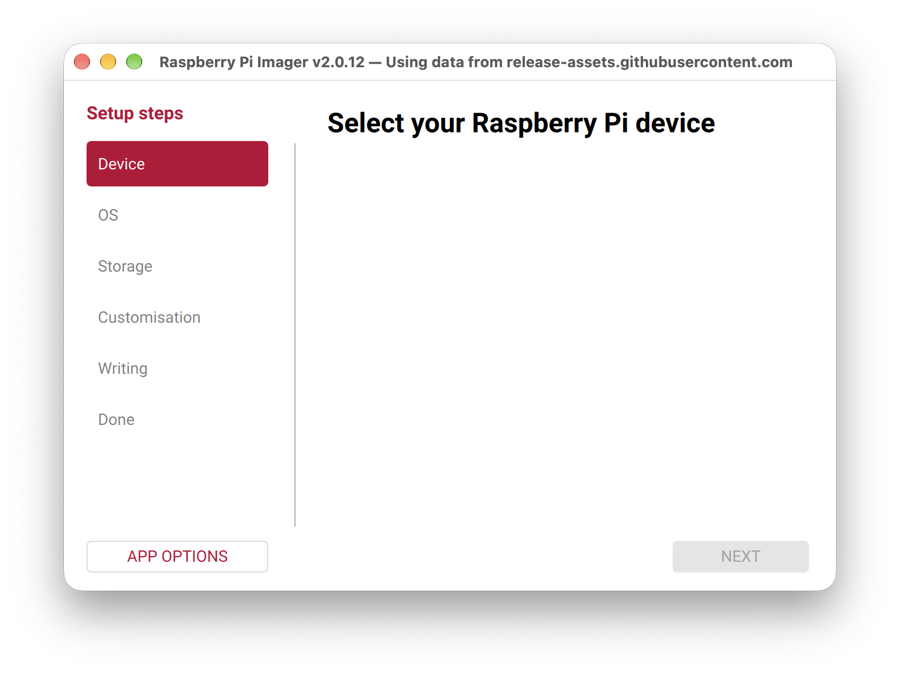
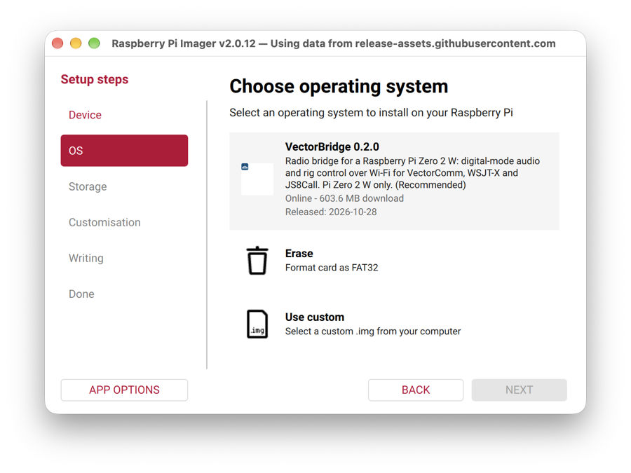
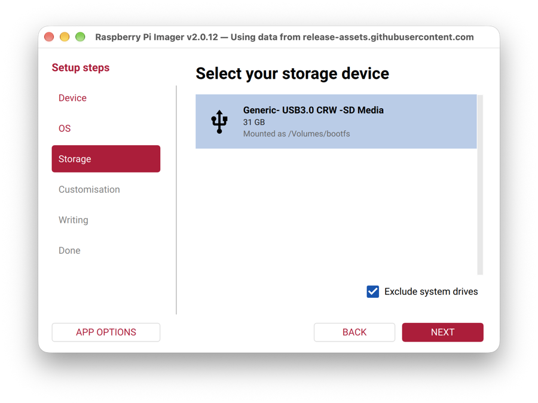
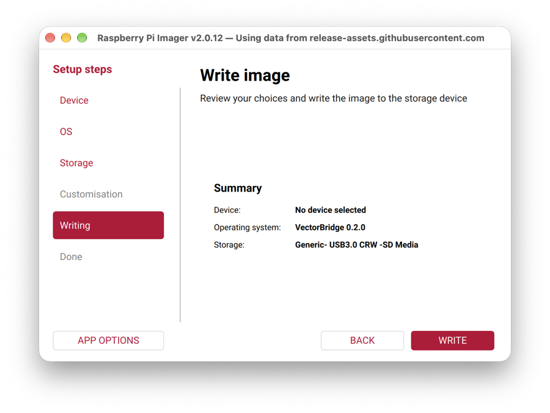
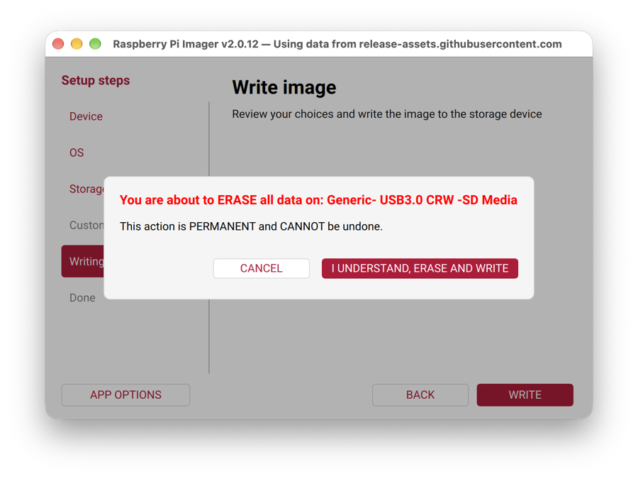
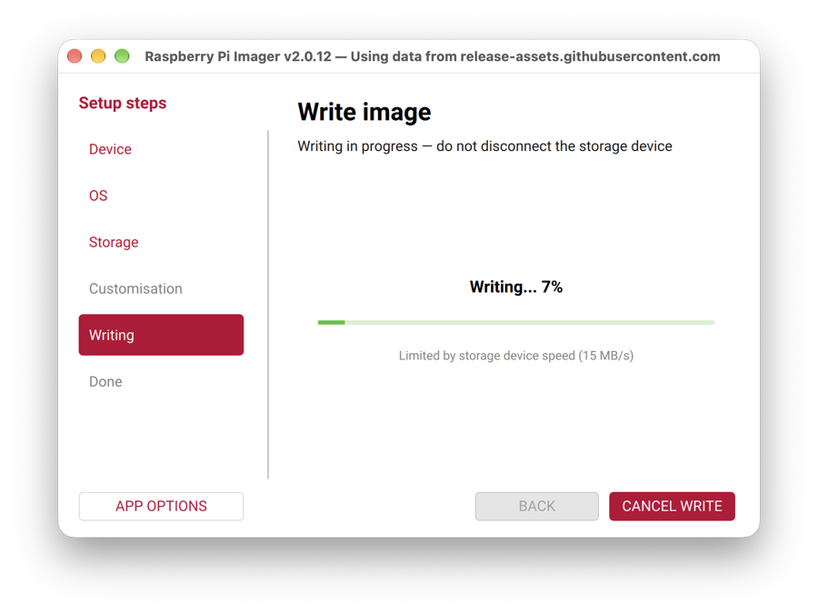
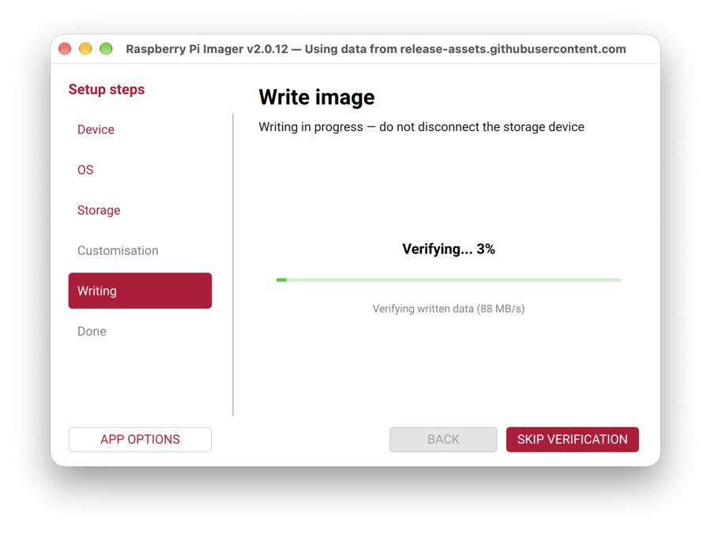
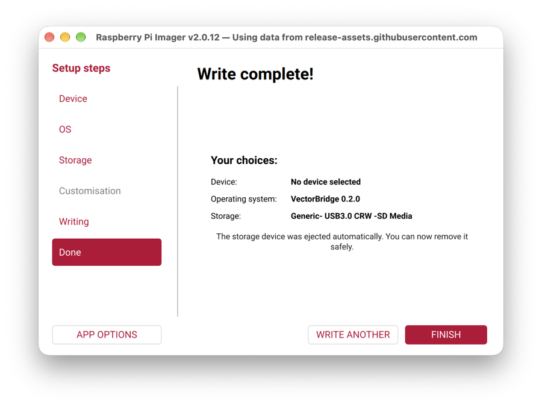

# Write the image with Raspberry Pi Imager

The steps, with pictures, on a Mac with Raspberry Pi Imager 2.0.12. The short version is in the README's
"End user" section. You need a Raspberry Pi Zero 2 W, a microSD card of 16 GB or more, a card reader and
a phone.

## 1. Add the VectorBridge repository

Imager reads its OS list from a repository URL. VectorBridge publishes one with each release, so you do
not download the image by hand. Either:

- start Imager from a terminal with the URL:

  ```
  "/Applications/Raspberry Pi Imager.app/Contents/MacOS/rpi-imager" --repo https://github.com/eusef/vector-bridge/releases/download/v0.2.0/os_list.json
  ```

- or download `vector-bridge-0.2.0.img.xz` from the release page and choose **Use custom** at step 3.

The window title then says "Using data from release-assets.githubusercontent.com": that is GitHub's
file host and is expected.

## 2. Device

With the VectorBridge repository the device list is empty, because the list carries one image and no
device catalogue. Press **Next**; the summary later says "No device selected", which is fine. (With
Imager's own list you would pick Raspberry Pi Zero 2 W; the image is built and tested on that board
only.)



## 3. OS

Pick **VectorBridge 0.2.0**. The entry shows the download size and release date; Imager checks the
download against the published checksum before writing.



## 4. Storage

Pick your card. Imager erases everything on it.



## 5. Customisation

The step is greyed out. VectorBridge does not use Imager's hostname, user, Wi-Fi or SSH settings; the
bridge asks for what it needs on its own first-boot page. If Imager ever offers the dialog, choose
**Skip customisation**.

## 6. Write

Review the summary, press **Write**, confirm the erase, and give Imager disk access when macOS asks.
Writing takes about ten minutes on a typical card and ends with a verify pass.









Imager ejects the card when the verify pass finishes.



## 7. First boot

Put the card in the Pi and power it. On its first boot the bridge makes an open Wi-Fi network named
`VectorBridge-XXXX`. Join it from your phone; the sign-in page opens by itself (if it does not, browse to
`http://vectorbridge/wifi`). Choose a new network name, a passphrase and your Wi-Fi country, save, and
the bridge reboots once. Then join the new network and open `http://vectorbridge/`
(`DOCS/setup-wizard.md` takes it from there).
