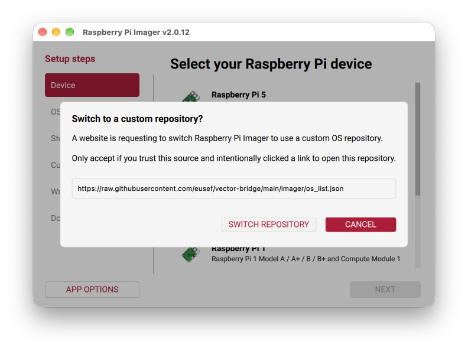
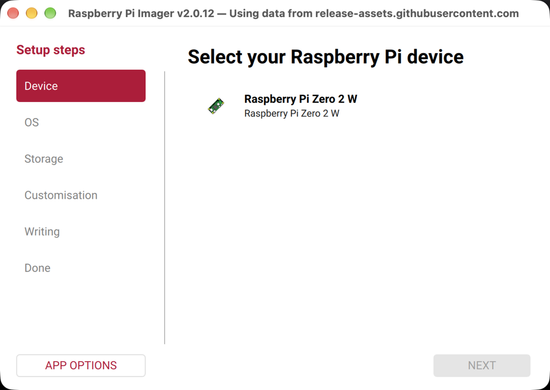
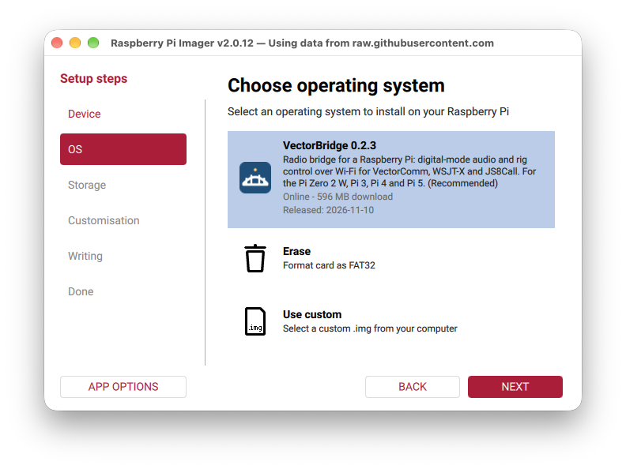
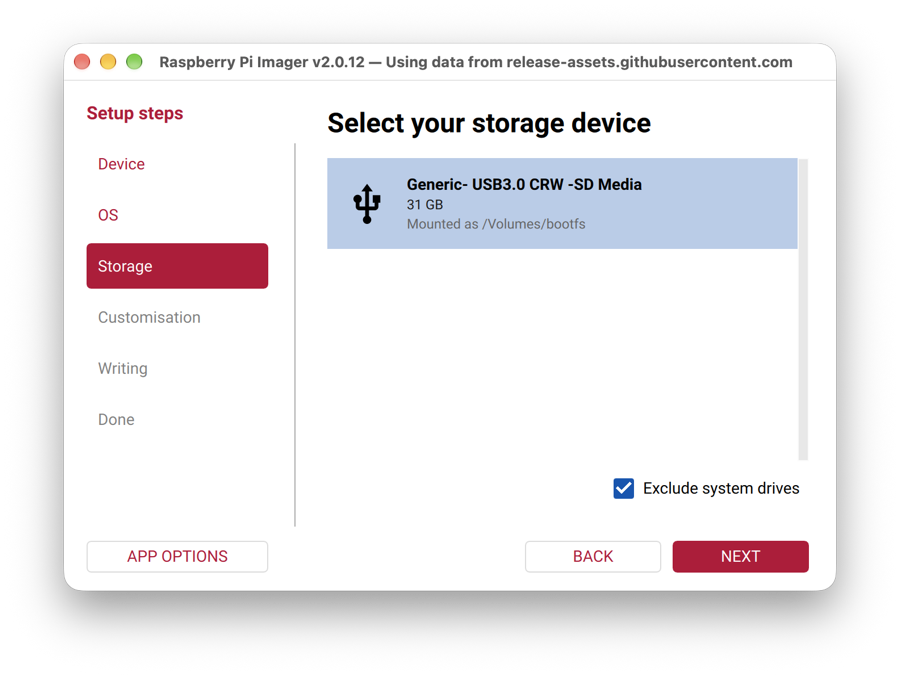
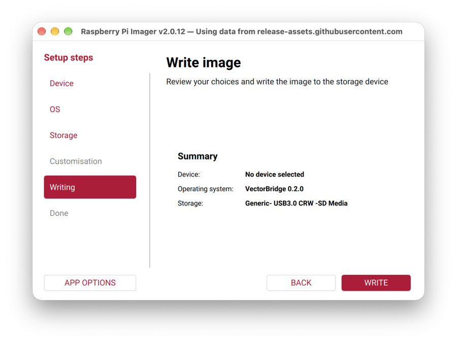
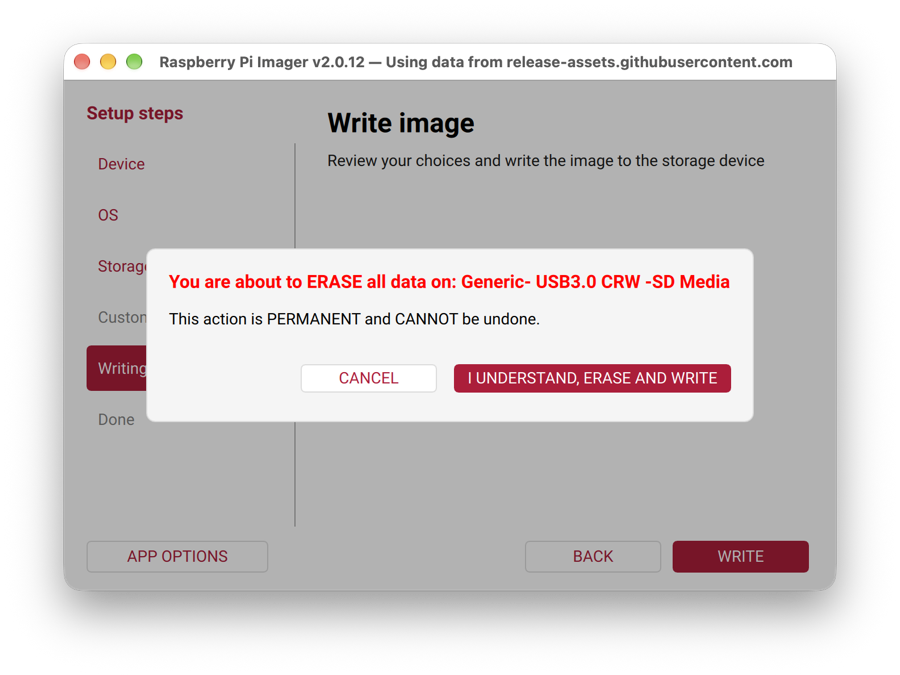
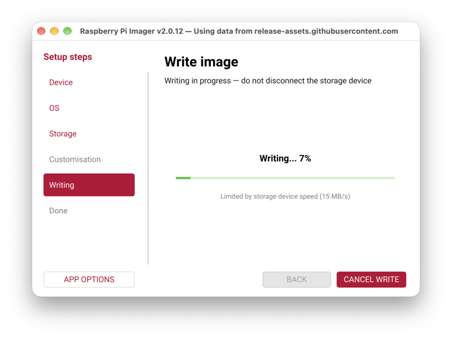
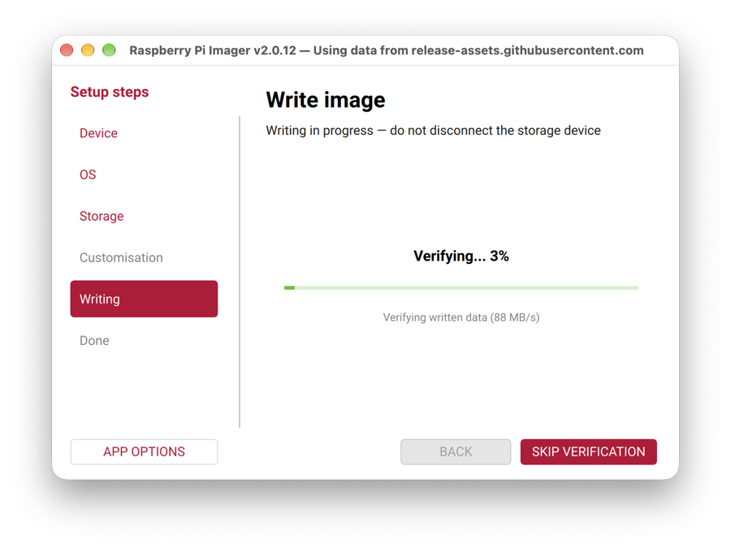
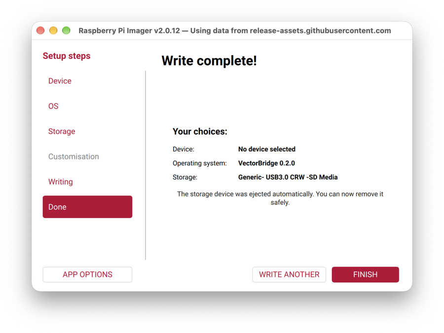

# Write the image with Raspberry Pi Imager

The steps, with pictures, on a Mac with Raspberry Pi Imager 2.0.12. The short version is in the README's
"End user" section. You need a Raspberry Pi (Zero 2 W, 3, 4 or 5), a microSD card of 16 GB or more, a card reader
and a phone. `VERSION` below is the release's version number, for example `0.2.3`.

## 1. Open Imager with the VectorBridge list

Install [Raspberry Pi Imager](https://www.raspberrypi.com/software/) 2.0.3 or newer. Imager reads its
OS list from a web address, and VectorBridge publishes one that always points at the newest release, so
you do not download the image by hand.

Copy this link, paste it into your web browser's address bar and press Enter:

```
rpi-imager://open?repo=https://raw.githubusercontent.com/eusef/vector-bridge/main/imager/os_list.json
```

The browser asks whether to open Raspberry Pi Imager: allow it. Imager then asks "Switch to a custom
repository?": press **Switch repository**. (**Cancel** is the highlighted button, so do not just press
Enter.)



Or paste one command into a terminal instead:

- Mac (Terminal):

  ```
  open "rpi-imager://open?repo=https://raw.githubusercontent.com/eusef/vector-bridge/main/imager/os_list.json"
  ```

- Windows (PowerShell):

  ```
  Start-Process "rpi-imager://open?repo=https://raw.githubusercontent.com/eusef/vector-bridge/main/imager/os_list.json"
  ```

- Linux:

  ```
  xdg-open "rpi-imager://open?repo=https://raw.githubusercontent.com/eusef/vector-bridge/main/imager/os_list.json"
  ```

The browser link and the Mac command are tested in Safari, Chrome and Terminal. The Windows and Linux
commands are not tested yet: if one does not work for you, please open an issue on GitHub saying what
happened.

The window title then says "Using data from raw.githubusercontent.com": that is GitHub's file host and
is expected. If nothing opens, Imager is not installed or is older than 2.0.3 (or, on Linux, was
never started once so it could register the link): install or update it, or download
`vector-bridge-VERSION.img.xz` from the release page and choose **Use custom** at step 3.

## 2. Device

Pick your board (**Raspberry Pi Zero 2 W**, **Raspberry Pi 3**, **Raspberry Pi 4** or **Raspberry Pi
5**) and press **Next**. The image is tested on the Zero 2 W, a Pi 3 Model B+ and a Pi 4 Model B; the
Pi 5 is not tested yet. (An older list with no device catalogue opens this page empty: press
**Next** and ignore "No device selected" on the summary.)



## 3. OS

Pick **VectorBridge VERSION**. The entry shows the download size and release date; Imager checks the
download against the published checksum before writing.



## 4. Storage

Pick your card. Imager erases everything on it.



## 5. Customisation

The step is greyed out. VectorBridge does not use Imager's hostname, user, Wi-Fi or SSH settings; the
bridge asks for what it needs on its own first-boot page. If Imager ever offers the dialog, choose
**Skip customisation**.

## 6. Write

Review the summary, press **Write**, confirm the erase, and give Imager disk access when macOS asks.
Writing takes about ten minutes on a typical card and ends with a verify pass.









Imager ejects the card when the verify pass finishes.



## 7. First boot

Put the card in the Pi and power it. On its first boot the bridge makes an open Wi-Fi network named
`VectorBridge-XXXX`. Join it from your phone; the sign-in page opens by itself (if it does not, browse to
`http://vectorbridge/wifi`). Choose a new network name, a passphrase and your Wi-Fi country, save, and
the bridge reboots once. Then join the new network and open `http://vectorbridge/`
(`DOCS/setup-wizard.md` takes it from there).
